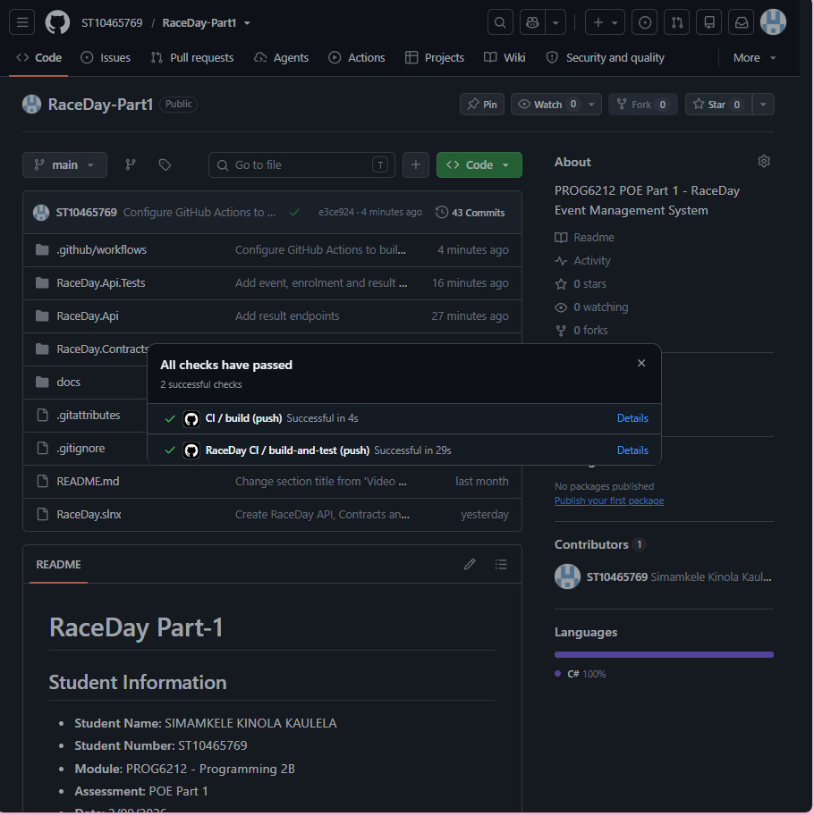
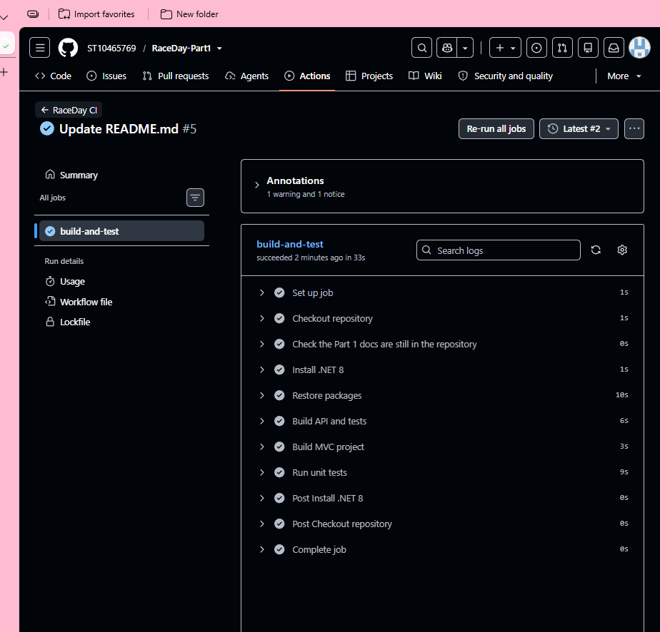

# RaceDay POE

## Student Information

- **Student Name**: SIMAMKELE KINOLA KAULELA
- **Student Number**: ST10465769
- **Module**: PROG6212 - Programming 2B
- **Assessment**: PoE Parts 1 to 3 (Final PoE)
- **Date**: 2/09/2026

## Project Description

RaceDay is a web-based event management system built for the South African road running, walking and
cycling community. Organisers can create and manage events, define age or distance categories, and
capture participant results. Participants can browse upcoming events, enter an event by selecting a
category, track their enrolments, and view their personal race history.

## User Roles

### Organiser
- Create, edit, and delete events
- Manage event categories
- View event enrolments
- Capture participant results
- View information relating to events they manage

### Participant
- Create an account and log in
- Browse available events
- Enter an event and select a category
- View their own enrolments
- Track their own race results and performance history

## Part 1 - System Planning and Database

### Entity Relationship Diagram (ERD)
- **File**: `docs/RaceDay_ERD.pdf`
- **Entities**: User, Event, Category, Enrolment, Result, Notification
- **Key Relationships**: One-to-Many between all entities
- **Primary Keys**: All entities have auto-incrementing ID fields
- **Foreign Keys**: Properly defined for all relationships

### API Endpoint Plan
- **File**: `docs/RaceDay_API_Endpoint_Plan.pdf`
- **Endpoints**: Authentication (2), User Profile (2), Events (5), Categories (4), Enrolments (5), Results (4)
- **Total Endpoints**: 22
- **Roles**: Public, Any (Logged In), Organiser, Participant

### SQL Database Script
- **File**: `docs/RaceDay_Database.sql`
- **Database**: MySQL
- **Tables**: 6 tables (User, Event, Category, Enrolment, Result, Notification)
- **Seed Data**: 2 Organisers, 2 Participants, 3 Events, Categories, Enrolments, Results, Notifications

## Repository Structure


## Database Setup

1. Open MySQL Workbench
2. Connect to your MySQL instance
3. Open `docs/RaceDay_Database.sql`
4. Execute the entire script
5. The script will:
   - Drop existing RaceDayDB 
   - Create a new RaceDayDB database
   - Create all 6 tables
   
## CI/CD

## CI/CD - GitHub Actions

The GitHub Actions workflow validates the repository structure by checking:
- `/docs` folder exists
- `RaceDay_ERD.pdf` exists
- `RaceDay_API_Endpoint_Plan.pdf` exists
- `RaceDay_Database.sql` exists
- `README.md` exists

### Successful Build Screenshot


## Video Presentation
YouTube link:
https://youtu.be/W6uhLkQWaiU


## Part 1 Video Content
- Introduction
- GitHub repository walkthrough
- ERD explanation (entities, relationships, cardinality)
- API Endpoint Plan explanation
- SQL script live demonstration in MySQL workbench
- Verification of seeded sample data
- GitHub Actions green build

## References

- PROG6212 PoE Document (2026)
- MySQL Workbench Documentation
- Draw.io Documentation

---

# Part 2 - RESTful API

## Technologies Used
- ASP.NET Core Web API (.NET 8), C#
- Entity Framework Core 8 (Code First) with SQL Server
- Swagger (Swashbuckle) for documentation and testing
- xUnit with WebApplicationFactory and the EF Core in-memory provider for tests
- GitHub Actions for CI

## Project Structure
- `RaceDay.Api` - controllers, models, DbContext, services, filters, migrations
- `RaceDay.Contracts` - shared DTOs for requests and responses
- `RaceDay.Api.Tests` - unit and integration tests
- `docs` - Part 1 ERD, endpoint plan and SQL script

## Database Setup
1. Install SQL Server Express and open SSMS.
2. In `RaceDay.Api/appsettings.json`, set `DefaultConnection` to your server (mine is `localhost\SQLEXPRESS`).
3. In Package Manager Console (default project `RaceDay.Api`) run `Update-Database`, or in a terminal run `dotnet ef database update --project RaceDay.Api`.
4. Open SSMS and confirm `RaceDayDb` has the tables `User`, `Event`, `Category`, `Enrolment`, `Result` and `Notification`.

## How to Run the API
1. Clone the repository and open the solution in Visual Studio 2022.
2. Set `RaceDay.Api` as the startup project and press F5.
3. Swagger opens at `http://localhost:5191/swagger`.

## Authentication
- Register hashes the password with PBKDF2 (random salt, 100,000 iterations). Only the hash is stored.
- Login checks the hash and stores `UserId` and `Role` in a server-side session.
- A `[SessionAuthorize]` filter protects endpoints: 401 if not logged in, 403 if the role is wrong.
- Organisers can only change their own events, categories, enrolments and results.

## API Endpoints
| Method | Route | Role |
|---|---|---|
| POST | /api/auth/register | Public |
| POST | /api/auth/login | Public |
| POST | /api/auth/logout | Public |
| GET | /api/users/profile | Any logged in |
| PUT | /api/users/profile | Any logged in |
| GET | /api/events | Any logged in |
| GET | /api/events/mine | Organiser |
| GET | /api/events/{id} | Any logged in |
| POST | /api/events | Organiser |
| PUT | /api/events/{id} | Organiser (owner) |
| DELETE | /api/events/{id} | Organiser (owner) |
| GET | /api/events/{eventId}/categories | Any logged in |
| POST | /api/events/{eventId}/categories | Organiser (owner) |
| PUT | /api/categories/{id} | Organiser (owner) |
| DELETE | /api/categories/{id} | Organiser (owner) |
| POST | /api/enrolments | Participant |
| GET | /api/enrolments/mine | Participant |
| GET | /api/enrolments/event/{eventId} | Organiser (owner) |
| PUT | /api/enrolments/{id}/status | Organiser (owner) |
| POST | /api/results | Organiser (owner) |
| GET | /api/results/mine | Participant |
| GET | /api/results/event/{eventId} | Organiser (owner) |

## Differences from my Part 1 plan
- The ERD and SQL script from Part 1 were written for MySQL. In Part 2 EF Core generates the same tables and columns for SQL Server. ENUM columns (Role, EventType, Status) became text columns, and the values are checked in the API.
- I added `GET /api/events/mine`, `GET /api/enrolments/mine`, `GET /api/enrolments/event/{eventId}`, `PUT /api/enrolments/{id}/status` and the results routes so each role has a clear way to view its own data.
- The Notification table exists in the database as in my ERD, but no Part 2 endpoint uses it.

## Swagger
Swagger lists the endpoints in six groups (Auth, Profile, Events, Categories, Enrolments, Results). Each endpoint has a summary, a description and its response codes.

## Unit Testing
Run `dotnet test RaceDay.Api.Tests/RaceDay.Api.Tests.csproj`, or use Test Explorer in Visual Studio. The tests use an in-memory database and cover registration, login, logout, profile access, event management, role enforcement, enrolments and results, with both success and failure cases.

## CI/CD
GitHub Actions restores, builds and tests the solution on every push.

### GitHub Actions Screenshot


## Video Presentation
[Part 2 video https://youtu.be/eI4RgX5tkyw ]

## AI Disclosure
I used an AI assistant to help plan the project structure, to troubleshoot setup errors and to review my code. I tested the API in Swagger, ran all the tests and can explain the code in my video.


---

# Part 3 - MVC Web Application, Azure Blob Storage and Docker

## Solution Structure
- `RaceDay.Mvc` - ASP.NET Core MVC front end (controllers, views, API client, session handling)
- `RaceDay.Api` - Part 2 REST API, which now also stores images in Azure Blob Storage
- `RaceDay.Contracts` - DTOs shared by the API and the MVC app
- `RaceDay.Api.Tests` - unit and integration tests
- `docs` - Part 1 ERD, endpoint plan and SQL script

## Architecture
Browser -> RaceDay.Mvc -> RaceDay.Api -> SQL Server / Azure Blob Storage.

The MVC project has no database code and never talks to Azure. After login it stores the user's id, name and role in its own session. It also keeps the API session cookie inside that MVC session, so every API call is authenticated as the right user. Each page is protected by a role filter: a logged-out user is redirected to Login, and the wrong role is redirected to Access Denied.

## Prerequisites
.NET 8 SDK, SQL Server Express, Visual Studio 2022, Docker Desktop, and an Azure Storage account.

## How to Run Locally
1. Set up the database as described in Part 2 (`Update-Database`).
2. Store the Azure connection string for the API in user secrets. It is never committed:
   `dotnet user-secrets set "AzureBlobStorage:ConnectionString" "<connection string>" --project RaceDay.Api`
3. In Visual Studio, set `RaceDay.Api` and `RaceDay.Mvc` as multiple startup projects and press F5.
4. The API runs on http://localhost:5191 and the MVC site opens in the browser.

## Azure Blob Storage Setup
1. Create a storage account in the Azure portal.
2. Create a container named `raceday-images`. The container is **private** (anonymous access is disabled).
3. Copy the connection string into user secrets as shown above.

Event banners and profile pictures travel from MVC to the API and then to Azure. The API saves the blob URL on the event or user (`BannerImageUrl`, `ProfilePictureUrl`). Because the container is private, the browser cannot open that URL directly. Instead MVC asks `GET /Images/...`, which calls `GET /api/images/...` on the API, and the API streams the image from Azure. Only the `event-banners` and `profile-pictures` folders can be read this way.

## Docker Setup
The MVC application runs in a container. Run these commands from the solution folder (the one containing `RaceDay.slnx`).

**1. Build the image**
```
docker build -f RaceDay.Mvc/Dockerfile -t raceday-mvc:part3 .
```

**2. Start the API on the host.** The container reaches the API through `host.docker.internal`, so the API must listen on all addresses:
```
dotnet run --project RaceDay.Api --no-launch-profile --urls http://0.0.0.0:5191
```

**3. Run the container**
```
docker run -d --name raceday-mvc -p 8080:8080 -e ApiSettings__BaseUrl=http://host.docker.internal:5191/ raceday-mvc:part3
```

**4. Open the site** at http://localhost:8080

Useful checks: `docker ps` shows the running container, and `docker logs raceday-mvc` shows its output. After changing the code, remove the old container with `docker rm -f raceday-mvc`, rebuild the image and run it again. The API must be running, otherwise the pages cannot load their data.

## Authentication and Session Flow
- Register and login are done through the API. Passwords are hashed with PBKDF2 and only the hash is stored.
- On login the API returns its session cookie. The MVC app saves it in the MVC session together with the UserId, Role and display name.
- Logout calls the API logout and clears the MVC session.
- Organiser and Participant users see different menus.

## Organiser Features
- Dashboard with events created, total enrolments and upcoming events
- Create, edit and delete events (name, description, date, location, distance, event type)
- Event banner upload
- Add and delete categories for each event
- View enrolments with the participant's category and a colour-coded status, and change the status
- Capture finish times and finishing positions for confirmed enrolments

## Participant Features
- Upcoming events with filters (event type and search)
- Event details with available categories and an Enter Event button
- My Events with the enrolment status (green for Confirmed, amber for Pending, grey for Cancelled)
- My Results with event, date, category, finish time and finishing position
- Profile page with update and profile picture upload

## Unit Testing
Run `dotnet test RaceDay.Api.Tests/RaceDay.Api.Tests.csproj`. The tests cover authentication, role enforcement, events, categories, enrolments, results and the image endpoints, with both success and failure cases.

## CI/CD
GitHub Actions restores and builds the API, the MVC project and the tests on every push, then runs all the unit tests.

### GitHub Actions Screenshot


## Differences and Notes
- The MVC client does not let the HTTP handler keep cookies (`UseCookies = false`). The API cookie is stored per user in the MVC session, so one user's API login is never reused for another user.
- The Azure container is private, so images are served through the API instead of using public blob URLs.
- The Azure connection string is stored in user secrets and is not in the repository.
- The Part 2 version of this project is tagged `part2-final`.

## Video Presentation
[Part 3 video (unlisted YouTube)](PASTE_YOUR_PART_3_LINK_HERE)

## AI Disclosure
I used an AI assistant (Claude) to help plan the MVC structure, to troubleshoot setup, Docker and Git errors, and to review my code. I tested each feature in the browser, in Swagger and in Docker, ran the unit tests, and can explain the code in my video.
